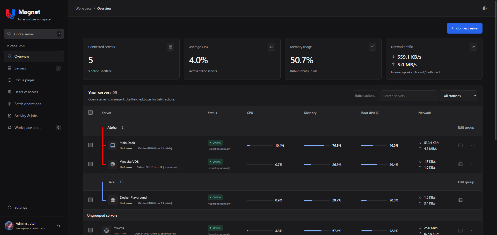
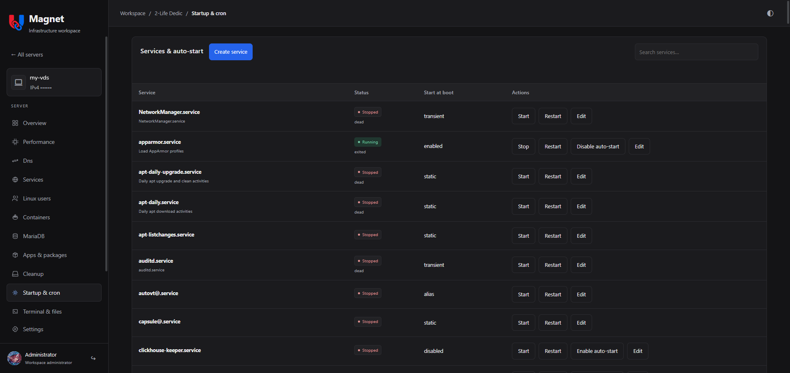

# 🧲 Magnet

Manage your Debian and Ubuntu servers from one dashboard. Monitor their health, update software, and handle everyday admin tasks in your browser.

## Features

- Monitor CPU, memory, disk, network traffic, and running processes.
- Install packages, run updates, and clean up disk space.
- Manage Docker containers, Compose projects, services, and scheduled tasks.
- Edit files, run commands, and manage Linux users and DNS settings.
- Browse MySQL, MariaDB, PostgreSQL, and SQLite databases and run SQL.
- Set up alerts and public status pages.
- Organize servers into groups and control who can access them.

## ⚡ Quick start
- Download MagnetServer to some separate folder
- Run the server using `./MagnetLink -install`
- Read admin password: `journalctl -u magnet-server.service -n 20 --no-pager`
- Set up reverse proxy (nginx, caddy etc) or just open `http://localhost:8080`
- Log in as admin, open servers page and click `Connect` -> `Generate setup command`
- Place a copy of MagnetLink on another server and run generated command
- Done!

For MagnetStatus  the process is generally same.

## Requirements

MagnetServer needs a MariaDB database. Service installation uses Debian or Ubuntu with systemd. Install MagnetLink on each server you want to manage.

## More information

- [Example configuration](MagnetServer/magnet.example.yaml)
- [Users, permissions, and single sign-on](MagnetServer/ACCESS.md)
- [Public status pages](MagnetStatus/README.md)

## License

Magnet is source-available under the [PolyForm Noncommercial License 1.0.0](LICENSE). Uses outside its permissions require a [commercial license](LICENSE-COMMERCIAL.md). See [licensing details](LICENSING.md).

For commercial licensing, contact [andreybest20027@gmail.com](mailto:andreybest20027@gmail.com).

Copyright (c) 2026 shoker137.
